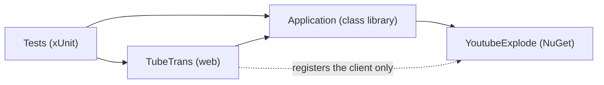
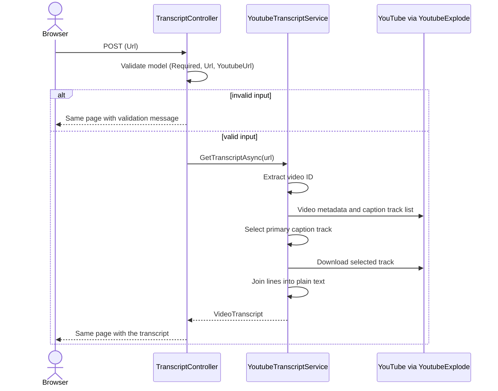

# Architecture

TubeTrans is a server-rendered ASP.NET Core MVC application that turns a YouTube video link into the plain-text transcript of that video, in its original language. It has no database and no accounts, and it keeps nothing between requests.

This document explains how the code is organized and how a request flows through it. The reasons behind the main design choices are recorded separately, as [decision records](decisions/README.md).

## Solution structure

```text
TubeTrans/
├── src/
│   ├── Application/              Class library: everything that is not web-specific
│   │   ├── Enums/                YoutubeUrlKind
│   │   ├── Exceptions/           TubeTransException and its subclasses
│   │   ├── Helpers/              YoutubeUrlHelper, CaptionTrackSelector (pure logic)
│   │   ├── Interfaces/Services/  IYoutubeTranscriptService
│   │   ├── Models/               VideoTranscript (domain model)
│   │   ├── Services/             YoutubeTranscriptService
│   │   └── ViewModels/           Request and response view models
│   │       └── Validation/       YoutubeUrlAttribute
│   └── TubeTrans/                Web project (ASP.NET Core MVC)
│       ├── Controllers/          TranscriptController, HomeController
│       ├── Views/                Transcript/Index, Home/Privacy, Home/Error, Shared/_Layout
│       ├── wwwroot/              CSS, JS and client libraries (Bootstrap)
│       └── Program.cs            Service registration and HTTP pipeline
├── tests/
│   └── Tests/                    xUnit tests
├── docs/                         SRS, architecture and decision records
├── TubeTrans.slnx
├── Directory.Build.props         Version shared by all projects
├── CHANGELOG.md
└── README.md
```

| Piece | Responsibility |
|---|---|
| `TranscriptController` | Receives the form, calls the service, maps the result to a view model and decides what the user sees when something fails |
| `YoutubeTranscriptService` | Gets the transcript of a video: extracts the ID, fetches metadata and captions, picks a track, joins the text |
| `YoutubeUrlHelper` | Recognizes YouTube URLs and extracts the video ID. Pure string logic, no network |
| `CaptionTrackSelector` | Chooses which caption track to use when a video offers several ([ADR 0004](decisions/0004-heuristic-caption-track-selection.md)) |
| `YoutubeUrlAttribute` | Validation rule used by the request view model |
| `VideoTranscript` | Domain model returned by the service |
| `TranscriptRequestViewModel` / `TranscriptResponseViewModel` | Form input and result shown by the view |

## Dependency rules



1. The web project depends on `Application`, never the other way around.
2. `Application` contains no ASP.NET Core types.
3. Controllers depend on `IYoutubeTranscriptService`, never on the concrete service.
4. YoutubeExplode is called only from `YoutubeTranscriptService`. `CaptionTrackSelector` consumes its caption track type, and `Program.cs` registers its client. Nothing else references it.

See [ADR 0002](decisions/0002-layered-solution-and-domain-model.md) and [ADR 0007](decisions/0007-service-interface-and-test-scope.md).

## Request flow



- `GET /` shows the empty form. It is the default route (`Transcript/Index`).
- `POST /` renders the same view again with the result. It does not redirect, because the application stores nothing between requests ([ADR 0005](decisions/0005-stateless-no-persistence.md)). One consequence is that refreshing the page re-submits the form.
- The view's model is the request. The outcome of the lookup travels separately, in `ViewBag.Response`, as a `TranscriptResponseViewModel`.

## Error handling

Errors are handled at four levels. Only the messages of `TubeTransException` subclasses are ever shown as they are ([ADR 0003](decisions/0003-typed-domain-exceptions.md)).

| Situation | Detected by | The user sees | Logged as |
|---|---|---|---|
| Empty, malformed, non-YouTube or Shorts link | Data annotations on `TranscriptRequestViewModel` | A validation message under the input | Not logged |
| Video private, deleted or nonexistent | The service translates YoutubeExplode's `VideoUnavailableException` into `VideoNotFoundException` | That exception's message | Warning |
| Video without captions | The service throws `TranscriptNotAvailableException` | That exception's message | Warning |
| Anything else: network failure, rate limiting, a bug | `catch (Exception)` in the controller | A generic message | Error, with the full exception |
| An exception outside the controller's `try/catch`, such as one thrown while rendering a view | `UseExceptionHandler("/Home/Error")`, outside Development only | The generic error page | By the framework |

## Cross-cutting concerns

**Dependency injection.** `YoutubeClient` and `IYoutubeTranscriptService` are registered as scoped (one instance per request). Both are stateless, so nothing is shared between users.

**Logging.** The default console and debug providers are used, filtered by `appsettings.json`. The controller logs at `Information` (success, with the elapsed time), `Warning` (expected errors) and `Error` (unexpected errors). The submitted URL is logged, but the transcript content never is.

**Configuration and environments.** The environment comes from `ASPNETCORE_ENVIRONMENT`. `launchSettings.json` only applies to local development and is ignored in production. `appsettings.json` is merged with `appsettings.{Environment}.json`, and the environment-specific file wins on conflicts.

**Static files.** Served with `MapStaticAssets` from `wwwroot`. Running unpublished in a non-Development environment needs a workaround, which is applied only in the `Staging` environment used to simulate production locally ([ADR 0008](decisions/0008-simulate-production-with-staging.md)).

## Front end

Razor views with Bootstrap 5, and almost no JavaScript.

- The layout is an "app shell": the header and footer stay fixed and only the content area scrolls.
- With no result, the search form is centered on the page. After a lookup, it moves to the top and the transcript appears below it in a read-only text area.
- The Copy button uses the browser's clipboard API entirely on the client, with no extra request. It requires HTTPS or `localhost`.

## Testing

xUnit tests cover the application's own logic: URL classification and ID extraction, the validation chain, caption track selection, and the controller (with a hand-written fake of the service). The service's `GetTranscriptAsync` is not unit-tested because it calls YouTube. See [ADR 0007](decisions/0007-service-interface-and-test-scope.md).

```bash
dotnet test
```

## Known limitations

- **Rate limiting.** YouTube may temporarily block requests from the server's IP when there are many in a short time. The user gets a generic message and the error is logged.
- **Unofficial access.** YoutubeExplode is not an official API. YouTube can change or block it without notice ([ADR 0001](decisions/0001-use-youtubeexplode.md)).
- **Track selection is a heuristic.** On videos with several caption tracks, the chosen one may not be the original language.
- **Not supported:** YouTube Shorts and videos without captions.

## Deployment notes

- The host must set `ASPNETCORE_FORWARDEDHEADERS_ENABLED=true` when it puts a proxy in front of the app, so the app sees the original scheme and client IP ([ADR 0009](decisions/0009-forwarded-headers-set-by-the-host.md)).
- In a real deployment the environment is `Production`, and nothing extra is enabled for static assets ([ADR 0008](decisions/0008-simulate-production-with-staging.md)).
